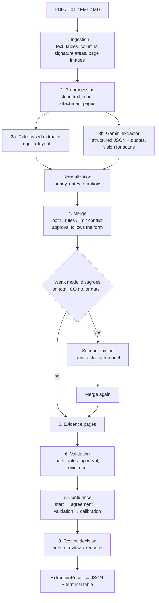

# Change-Order Extractor

Turn messy construction **change orders** (PDFs, scanned forms, emails, pasted text, field notes) into **validated JSON with an evidence quote and a calibrated confidence score for every field**, and a clear **"needs review"** decision with reasons.

```
file ──► read ──► clean ──► find attachments ──► extract (rules + Gemini) ──► normalize
     ──► merge ──► (second opinion) ──► validate ──► score + calibrate ──► JSON + review flag
```

A change order is the document that changes a construction contract: extra work, deleted work, a new price, more (or fewer) days on the schedule. In practice they arrive as clean forms, AIA G701 and EJCDC C-941 forms full of contract sums, scanned paper with handwritten signatures, PDFs with pages of backup quotes attached, emails, and shorthand like `lab 800 mat 450 +2 days?`.

This project reads all of these, extracts 18 fields, checks that they make sense, and tells you **how much to trust each value and why**. When a document needs a human, it says so and explains why.

---

## Contents

1. [What you get](#1-what-you-get)
2. [Results at a glance](#2-results-at-a-glance)
3. [Setup and quick start](#3-setup-and-quick-start)
4. [How it works: the complete flow](#4-how-it-works-the-complete-flow)
   - [4.1 Ingestion](#41-ingestion-reading-the-file)
   - [4.2 Preprocessing](#42-preprocessing-cleaning-and-finding-attachments)
   - [4.3 Normalization](#43-normalization-money-dates-durations)
   - [4.4 Rule-based extraction](#44-rule-based-extraction)
   - [4.5 Gemini extraction](#45-gemini-extraction)
   - [4.6 Merge](#46-merge-combining-the-two-extractors)
   - [4.7 Second opinion](#47-second-opinion-from-a-stronger-model)
   - [4.8 Evidence pages](#48-evidence-pages)
   - [4.9 Validation](#49-validation)
   - [4.10 Confidence scoring and calibration](#410-confidence-scoring-and-calibration)
   - [4.11 Review decision](#411-the-review-decision)
5. [Output format](#5-output-format)
6. [Evaluation](#6-evaluation)
7. [Calibration](#7-calibration)
8. [Command reference](#8-command-reference)
9. [Using it from Python](#9-using-it-from-python)
10. [Configuration](#10-configuration)
11. [Working with Gemini: quota, fallbacks, cache](#11-working-with-gemini-quota-fallbacks-cache)
12. [Test data](#12-test-data)
13. [Testing](#13-testing)
14. [Project structure](#14-project-structure)
15. [Design decisions](#15-design-decisions)
16. [Known limitations and failure modes](#16-known-limitations-and-failure-modes)
17. [Roadmap](#17-roadmap)

---

## 1. What you get

### Fields extracted (18)

| Group | Fields |
|---|---|
| Identification | `change_order_number`, `project_name`, `project_number`, `date` (the date the change order was issued) |
| Parties | `contractor`, `owner` |
| Scope | `description`, `reason` |
| Money | `line_items` (each with `description`, `category`, `quantity`, `unit`, `unit_price`, `amount`), `subtotal`, `markup_amount`, `tax_amount`, `total` (negative for a credit) |
| Schedule | `schedule_impact_days` (whole days; `0` = no change; negative = time removed) |
| Approval | `status` (`approved` / `pending` / `rejected` / `unknown`), `requested_by`, `approved_by`, `approval_date` |

Line-item categories: `labor`, `material`, `equipment`, `subcontract`, `markup`, `tax`, `other`.

### For every field

| Key | Meaning |
|---|---|
| `value` | The normalized value: dates as `2025-03-05`, money as `3685.0` (negative for credits), schedule as whole days |
| `evidence` | The **exact quote** from the document the value came from, so a reviewer can check it in seconds |
| `page` | The page that quote is on (shown as `(p.2)` in the terminal) |
| `confidence` | 0.0 to 0.99, **calibrated**: "0.9" means "values like this were right about 9 times in 10" |
| `source` | Who found it: `rules`, `llm` (Gemini), `both` (they agree) or `conflict` (they disagree) |
| `notes` | Plain-English reasons behind the score, e.g. *"two-digit year"*, *"rules and Gemini agree"*, *"validation error: total_mismatch"*, *"calibrated 0.77 -> 0.99 (rules_alone values: 162 of 162 right in evaluation)"* |

### For the whole document

- a **validation report**: every problem found, as an error or a warning
- `overall_confidence`
- `needs_review` with a list of `review_reasons`
- which extractors ran, and which Gemini model answered
- pipeline `warnings` (e.g. *"Gemini failed; used rules only"*)
- the pages detected as **attachments** (backup documents)
- processing time

---

## 2. Results at a glance

Measured with the built-in evaluation harness ([section 6](#6-evaluation)). The test set is 20 documents with hand-checked answers: 16 generated samples and 4 real public change orders. The run was on 2026-10-07, with `gemini-flash-lite-latest` and calibration on.

| Metric | Rules only | Gemini only | **Hybrid** |
|---|---|---|---|
| Documents fully correct | 14/20 | 14/20 | **15/20** |
| Field accuracy | 88% | 96% | **97%** |
| Precision (returned values that are right) | **100%** | 96% | 98% |
| Recall (stated values found) | 83% | 97% | **98%** |
| Hallucinated values (returned, but not in the document) | **0** | 6 | 4 |
| Line items found | 33/41 | 41/41 | **41/41** |
| Calibration error (ECE, lower is better) | 0.05 | 0.05 | 0.05 |
| Review flag: documents with errors that were flagged | 5/6 | 3/6 | 3/5 |
| Review flag: correct documents flagged anyway | 2/14 | 4/14 | 4/15 |
| Not flagged **and** fully correct | 12/13 (92%) | 10/13 (77%) | **11/13 (85%)** |
| Seconds per document (Gemini answers cached) | 0.26 | 0.27 | 0.25 |

What this shows:
- **The rules are precise but incomplete.** Every value they return is right, but they miss 17% of the values.
- **Gemini finds almost everything,** but sometimes invents values. Almost all of its errors are approval details.
- **Hybrid gets the best of both.** Its scores are honest: values from both extractors scored 0.99 and were right 198 times out of 199.
- **Calibration is honest:** checked with leave-one-document-out cross-validation, the calibration error falls from **0.189 to 0.045** ([section 7](#7-calibration)).

**Read these numbers with care.** 20 documents is a small set: one document moves a percentage by about 5 points. Most documents are samples written for this project, and the calibration was fitted on these same documents. The cross-validated 0.045 is the honest calibration number.

---

## 3. Setup and quick start

### Requirements

- **Python 3.11 or newer** (developed on 3.12)
- **[uv](https://docs.astral.sh/uv/)**, the Python package manager used here
- A **Gemini API key** (free at [aistudio.google.com/apikey](https://aistudio.google.com/apikey)). This is optional: without a key the tool runs in rules-only mode and says so.

### Install uv (once)

```bash
# macOS / Linux
curl -LsSf https://astral.sh/uv/install.sh | sh
```
```powershell
# Windows PowerShell
powershell -ExecutionPolicy ByPass -c "irm https://astral.sh/uv/install.ps1 | iex"
```

### Set up the project

```bash
cd change-order-extractor

# 1. Install all dependencies into .venv (includes the test tools)
uv sync --all-extras

# 2. Create your settings file
cp .env.example .env              # Windows PowerShell:  copy .env.example .env
#    Open .env and set:  GEMINI_API_KEY=your-key
#    Free-tier tip: also set COX_GEMINI_MODEL=gemini-flash-lite-latest (see section 11)

# 3. Check that the key works
uv run python scripts/check_gemini.py

# 4. Generate the 16 sample documents and their correct answers
uv run python scripts/generate_samples.py

# 5. Run the test suite (offline: no Gemini requests)
uv run pytest
```

### Your first extraction

```bash
# One file, rules + Gemini, full table in the terminal; JSON saved to outputs/
uv run cox extract data/samples/co_001_clean.txt

# The same without Gemini (free, offline)
uv run cox extract data/samples/co_001_clean.txt --no-llm

# A whole folder, with a summary table
uv run cox extract data/samples --no-llm --out outputs/rules_only

# A real document (put your own PDF or .txt in data/real/)
uv run cox -v extract "data/real/my change order.pdf" --out outputs/hybrid
```

> **Windows note:** put paths with spaces in quotes. The `-v` (verbose) option goes **before** `extract`.

---

## 4. How it works: the complete flow



| # | Stage | What happens | Code |
|---|---|---|---|
| 1 | Ingestion | File → `Document`: text per page, tables, labelled columns, signature areas, a PNG for each scanned page | `ingestion/` |
| 2 | Preprocessing | Remove leader dots, fill-in lines and odd characters (never a letter or digit); mark backup pages as attachments | `preprocessing/` |
| 3a | Rule-based extraction | Regex + layout find labelled values and money lines, each with its exact line as evidence | `extraction/rule_based.py`, `line_items.py` |
| 3b | Gemini extraction | The LLM returns raw values + verbatim quotes in an enforced JSON schema; reads scans with vision | `extraction/llm_extractor.py`, `prompts.py` |
| – | Normalization | One set of parsers, used by **both** extractors: `"$3,685.00"` → `3685.0`, `"Mar 5th, 2025"` → `2025-03-05`, `"2 weeks"` → `14` | `normalization/` |
| 4 | Merge | Combine both extractors field by field; resolve conflicts; approval follows the form | `scoring/merge.py` |
| 4b | Second opinion | When a weaker model disagrees with the rules on a critical field, ask a stronger model | `pipeline.py` |
| 5 | Evidence pages | Find which page each quote is on | `extraction/fields.py` |
| 6 | Validation | 12 checks: required fields, math, dates, approval, evidence (anti-hallucination) | `validation/rules.py` |
| 7 | Scoring | Final, calibrated confidence per field; overall score | `scoring/confidence.py`, `calibration.py` |
| 8 | Review decision | `needs_review` + `review_reasons` | `scoring/confidence.py`, `pipeline.py` |

Only `pipeline.py` knows the order of the stages. Every other folder is one stage that can be tested on its own.

### The hybrid strategy

Two **independent** extractors read every document:

| | Rule-based (regex + layout) | Gemini (LLM) |
|---|---|---|
| Strengths | Fast, free, deterministic, very precise on clear labels and known forms | Understands messy wording, unusual layouts, emails and **scanned images** |
| Weaknesses | Can't read scans; misses unusual wording | Can misread or invent; costs quota; can be busy or unavailable |
| Design rule | **Precise, not complete:** when unsure, leave the field empty | Must quote its evidence verbatim; never calculates values |

- When they **agree**, confidence goes up sharply (measured: 198 of 199 such values were right).
- When they **disagree**, a winner is picked, the losing value is kept in the notes, and the document goes to review if the field is critical.
- Both use **the same normalizers**, so "the same value" really compares equal.
- If Gemini is unavailable, you still get the rules' result, with a warning.

---

### 4.1 Ingestion: reading the file

`ingestion/loader.py` picks a reader by file extension and returns a `Document` (a list of `Page`s).

**Supported files:** `.pdf`, `.txt`, `.text`, `.md`, `.eml`. Anything else, and missing, empty, corrupt or password-protected files, raise a clear `IngestionError`. A batch run reports that file and carries on.

**Text files** (`text_reader.py`):
- decoded as UTF-8 (BOM removed), then Windows-1252, then Latin-1, so reading never fails on an encoding
- the whole file becomes one page

**PDFs** (`pdf_reader.py`, using pdfplumber). For each page it reads:

| What | How |
|---|---|
| **Text** | pdfplumber's text layer |
| **Tables** | pdfplumber's table finder (real ruled tables) |
| **Labelled columns** | `layout.py: read_columns`. Side-by-side form headers like AIA G701's `PROJECT:` / `CONTRACT INFORMATION:` / `CHANGE ORDER INFORMATION:` are split **by word position**, so each column's lines stay together (`Page.columns`). A header line needs at least two upper-case labels ending in `:` |
| **Signature areas** | `layout.py: read_signatures`. The ARCHITECT / CONTRACTOR / OWNER / ENGINEER columns of a signature area, each with firm, printed name and date (`Page.signatures`). Two layouts are understood: AIA 2017 (firm above, captions `SIGNATURE` / `PRINTED NAME AND TITLE` / `DATE` below) and `By: name date` lines |
| **Scanned pages** | rendered to a 200 DPI PNG so Gemini can read them (vision) |

**Scan detection.** A page counts as scanned when:
- it has fewer than **20** real characters, **or**
- one image covers at least **80%** of the page **and** it has fewer than **200** characters.

The second rule matters because agenda systems often stamp a text footer ("Change Order No. 1 to C-24-0312-09-27 / 1 of 4") on scanned pages. Without it, such a page would be treated as text, and nobody would read the image. The stamped text is kept and shown to Gemini next to the image. An OCR'd scan with a full text layer (hundreds of characters) is read as text.

**Source type:** `text`, `pdf_text`, `pdf_scanned` (every page is an image) or `pdf_mixed`.

---

### 4.2 Preprocessing: cleaning and finding attachments

**Cleaning** (`preprocessing/cleaner.py`) tidies text without changing meaning:

| Before | After |
|---|---|
| `Labor ........ $1,200.00` | `Labor  $1,200.00` |
| `Approved by: __J. Martinez____   Date: 3/7/25` | `Approved by:  J. Martinez  Date: 3/7/25` |
| `Materials .... $  940.00` | `Materials  $940.00` |
| `“Owner” request – add’l` | `"Owner" request - add'l` |

- **Golden rule: cleaning never adds, removes or changes a letter or digit.** A test enforces this on every sample. That's what lets validation check that every evidence quote really exists in the document. OCR errors like `2,915.OO` are fixed later, only inside money and date values.
- Runs of two or more spaces become exactly two spaces: a **column gap**. It marks where a value ends on a form line (`Project: Riverside Medical Clinic  Job No. 2291`).
- Table cells, columns and signature blocks are cleaned the same way.

**Finding attachments** (`preprocessing/segmenter.py`). Real change orders often come with backup pages: cost memos, subcontractor quotes, date-calculator printouts. Those pages have their own `TOTAL:`, `Job #`, `CO #` and dates, and must not be read as the change order.
- Page 1 is always the change order.
- A later page starts a **new document** (an attachment) when its first 12 lines show:
  - a memo header: two or more of `DATE:` / `TO:` / `FROM:` / `RE:` / `SUBJECT:` / `CC:` / `ATTN:`
  - a document title: QUOTE, QUOTATION, PROPOSAL, INVOICE, ESTIMATE, CHANGE ORDER REQUEST, PURCHASE ORDER
  - `Page 1 of N` (a new document's page numbering restarts)
- A page that says it continues the change order (`Page 2 of 3`, "continued") does not start one.
- **Every page after the first attachment is an attachment too:** backup comes after the document it supports. A scanned page can't *start* an attachment (it has no text), but it can be one.
- The rules read **only the main pages** (`Document.main_text`). Gemini sees everything, but attachment pages are labelled `[Page N - ATTACHMENT (backup document)]`, with an instruction to take the fields from the change order only.

---

### 4.3 Normalization: money, dates, durations

Every parser returns the value **plus notes** on anything it had to interpret. No notes means the text said exactly this. Each note lowers the starting confidence by 0.10.

**Money** (`normalization/money.py`)

| Input | Value | Note |
|---|---|---|
| `$3,685.00` | `3685.0` | – |
| `($8,400.00)` / `500.00 CR` / `credit of $250` | `-8400.0` / `-500.0` / `-250.0` | credit wording |
| `Decrease of this Change Order: $14,000.00` | `-14000.0` | credit wording ("decrease") |
| `-$500` / `$-500` | `-500.0` | – |
| `Steel - $5,000.00` / `$ - $9,700.00` | `5000.0` / `9700.0` | a dash is only a minus when it **touches** the amount; a separator or an empty accounting column (`$ -`) is not |
| `S5,000.00` (OCR) | `5000.0` | OCR "S" read as "$" |
| `2,915.OO` | `2915.0` | fixed OCR look-alike characters |
| `labor: 18 hrs @ $85/hr = $1,530` | `1530.0` | several numbers; used the result after `=` |
| `Four Thousand Two Hundred Fifty Dollars ($4,250.00)` | `4250.0` | the parentheses repeat the amount, so not a credit |
| `$7.8k` | `7800.0` | `k` read as thousands |
| `1.234,56` | `1234.56` | European format |

**Dates** (`normalization/dates.py`)

| Input | Value | Note |
|---|---|---|
| `Mar 5th, 2025` / `05-Mar-2025` / `November 5, 2020` | `2025-03-05` / … | – |
| `3/7/25` | `2025-03-07` | two-digit year; day/month order ambiguous (month first assumed) |
| `1O/03/2024` | `2024-10-03` | fixed OCR |

**Durations** (`normalization/durations.py`)

| Input | Days | Note |
|---|---|---|
| `five (5) working days` / `Zero (0) days` | `5` / `0` | – |
| `2 weeks` | `14` | converted weeks to days |
| `No schedule impact` / `No change` / `none` | `0` | – |
| `+2 days?` | `2` | marked as uncertain |
| `Total is $2,070` | – | money amounts are never read as days |

**Text helpers** (`normalization/common.py`):
- OCR digits are fixed only inside number-like tokens (`T0TAL 2,915.OO` → `T0TAL 2,915.00`).
- OCR letters are fixed only when a `0`/`1` sits **between two letters** (`C1ubhouse` → `Clubhouse`), so codes like `RTU-3` and `A101` are untouched.
- Number words are read (`Eight` → 8).
- Printed form instructions such as `(Name and address)` or `(Insert a detailed description…)` are removed, so they are never taken as values.

---

### 4.4 Rule-based extraction

`extraction/rule_based.py` and `extraction/line_items.py`. These are regular expressions plus the layout from ingestion, built to be **precise, not complete**. A test checks that **every value the rules return on the samples is correct**. When a pattern is unclear, the field is left empty for Gemini.

**Labelled fields**

| Field | How it is found |
|---|---|
| CO number | `Change Order #`, `Change Order No.`, `CO-014`, `Change Order Number: 10` (in the CHANGE ORDER column first). The first CO number wins, so "supersedes CO-017" is ignored |
| Project name / number | `Project:` / `Job No.` / `Project #`; on AIA forms from the PROJECT column (`777.01 Marshall Municipal Building` → number `777.01`, name `Marshall Municipal Building`) |
| Date | 1. the date in the form's **CHANGE ORDER column** (AIA); 2. an **issue-date label** (`Date of Issuance:`, `Issue Date:`, `Date Issued:`), which beats an `Effective Date:` on the same line; 3. the first `Date:` that isn't on an approval line (noted when the line has several dates); 4. a bare date line near the top of shorthand notes |
| Contractor / owner | `Contractor:` / `Owner:` / `To:` and the form's OWNER / CONTRACTOR columns; email addresses rejected; letterhead used as a heuristic |
| Description | `Description:` / `Scope of Work:` / `The contract is changed as follows:`, continued over the following lines |
| Reason | `Reason:`, or, when there is none, the referenced documents (`PR04; RFI 24; RFI 27`, from RFI / ASI / PR / PCO / CCD / COR numbers; heuristic confidence) |
| Requested by | `Requested by:` |

A value stops at the next column gap or the next label, including the next column's label on forms like EJCDC C-941 (`Contractor's Project No.:`, `Owner's Contract No.:`, `Contract Name:`).

**Money** (`line_items.py`), in this order:
1. **Real PDF tables** are read first, column by column (Description, Qty, Unit, Unit Price, Amount).
2. **Summary lines** are recognised by label: Subtotal, Tax, Markup / OH&P / Fee / Profit, TOTAL (also OCR `T0TAL`), Net credit, Net add, Lump sum.
3. **AIA G701:** *"The Contract Sum will be increased by this Change Order in the amount of $X"* is the change order's total. It beats any `TOTAL:` line (those usually belong to a cost breakdown). "decreased" makes it negative.
4. **EJCDC C-941:** `Decrease of this Change Order:` / `Increase of this Change Order:` with the amount on one of the next lines (the contract-times column sits next to it). "Decrease" makes it negative.
5. Any other line that **ends with an amount** is a line item. `48 EA @ $145.00` fills quantity, unit and unit price, and the category comes from keywords (labor, material, equipment, subcontract).

**Schedule**
1. EJCDC: the `Substantial Completion:` line in **this change order's** contract-times column. `NA` means no change (0 days).
2. Labelled sentences: `Contract Time will be increased by Zero (0) days`, `Time Extension: 2 weeks`, `No schedule impact`.
3. A heuristic for any line with "N days". Contract-time **totals** (`Substantial Completion: 360 calendar days`) are never used: they are not the change.

**Approval** (the first match wins):
1. `rejected` / `declined` / `denied` → rejected
2. `Approved by: NAME  Date: …` → approved, with approver and date
3. The form's **OWNER signature column**: a dated owner signature → approved (approver and date from that column); a **blank owner date → pending**. A printed name alone is not a signature, and another column's date (e.g. the architect's) is not the owner's approval.
4. `pending` → pending; a blank `Approved by:` line → pending (heuristic)

**Starting confidence:** 0.85 for a value next to an explicit label, 0.55 for a heuristic (e.g. contractor from the letterhead), minus 0.10 for each normalization note.

---

### 4.5 Gemini extraction

`extraction/llm_extractor.py` (calling Gemini) and `extraction/prompts.py` (what it is told).

**How the call works**
- Called through the `google-genai` SDK with `response_mime_type="application/json"` and a **Pydantic response schema** (`LLMChangeOrder`), so Gemini must answer in our JSON shape. Temperature 0.
- Gemini returns, for every field, the **raw text as written**, a **verbatim evidence quote**, and a certainty (`high` / `medium` / `low` → 0.85 / 0.65 / 0.45). **Our normalizers** then turn the text into values, the same ones the rules use.
- **Scanned pages** are sent as images, together with any stamped text layer.
- **Attachment pages** are labelled in the text, and the prompt says which pages they are.
- A value read from a scan (its quote is not on any text page) gets the note *"read from a scanned image"*.
- **Sign from the quote:** if Gemini writes `$14,000.00` but quotes `Decrease of this Change Order: $14,000.00`, the value becomes −14,000 (with a note). This only happens when the quote clearly says credit / deduct / decrease, and not also "increase" or "add".

**What the prompt teaches** (versioned as `PROMPT_VERSION`, currently `v8`; the version is part of the cache key):
- Quote evidence exactly, including the label that gives a value its meaning (`Decrease of this Change Order: $14,000.00`, not just `$14,000.00`).
- Never guess or calculate; report wrong math as written.
- Take every field from the change order, not from attachments; printouts (quotes, emails, date calculators) are backup.
- AIA G701: the CO number and date are in the CHANGE ORDER INFORMATION column; the contract's date is not the CO date; `(Name and address)` is an instruction, not a value.
- The total is *this* change order's amount, not a contract sum. A net-zero change has total `$0.00`, not null; `$ -` in a TOTALS row means zero.
- A dash is only a minus when it touches the amount; in multi-column cost tables, a line item's amount is the row's TOTAL column.
- Markup and tax are not line items; a lump sum has no line items.
- Schedule: only the **change** in contract time counts; original or new contract times are not the change; `NA` or unchanged times mean "No change".
- The project name is the `Project` value; a separately labelled `Contract Name` is not part of it.
- Names without job titles; the reason may be a list of references (`PR04; RFI 24; RFI 27`).
- Approval:
  - only the OWNER column decides approval
  - a printed name is not a signature
  - a blank owner date means pending
  - pre-printed approval wording above blank signature lines (`APPROVED BY COMMISSIONERS' COURT ON …`) is not an approval

**Reliability** (details in [section 11](#11-working-with-gemini-quota-fallbacks-cache)):
- retries with backoff
- quota fast-fail
- fallback models
- an on-disk cache
- a fast, optional second opinion

The pipeline **never fails because of Gemini**. Without a key, or when every model fails, you get the rules' result, a warning, and a review reason.

---

### 4.6 Merge: combining the two extractors

`scoring/merge.py`, field by field:

| Rules | Gemini | Result | `source` |
|---|---|---|---|
| found | – | the rules' value | `rules` |
| – | found | Gemini's value | `llm` |
| found | found, **agree** | one value (Gemini's wording for text and line items, the rules' parse otherwise) | `both` |
| found | found, **disagree** | a winner; the loser is written in the notes | `conflict` |

**Agreement is type-aware:**
- money: within 1 cent
- IDs: `CO-014` = `CO 14`, `0005` = `5`
- names: at least 0.85 similar, or one contains the other (`Linda Chen` ≈ `Linda Chen, Facilities Director`)
- descriptions: at least 0.6 similar
- line items: the same set of amounts
- dates, days, status: exactly equal

**Picking the winner of a conflict, in order:**
1. the value whose evidence quote **really is in the document** (checked on text pages, also in partly scanned PDFs)
2. for the total: the value that equals line items + markup + tax
3. a **stronger model's second opinion** (see 4.7)
4. the clearly higher starting confidence (difference of at least 0.1)
5. by field type: rules for numbers, dates and IDs; Gemini for text, names and line items

**Approval follows the form:**
- When the form has an OWNER signature column, that column decides the status (blank owner date → pending, dated → approved). If the rules read it that way and Gemini says otherwise (for example, it took a printed name for a signature), the form wins and Gemini's status is ignored, with a note.
- A change order that ends up **pending or rejected** keeps no approver or approval date that only Gemini gave (for example, the architect's date). They are removed and kept in a note.

---

### 4.7 Second opinion from a stronger model

When the model that answered is **not** one of the strong models (for example, a "lite" fallback) and it **disagrees with the rules** on the total, CO number or date:
- `pipeline.py` asks the models in `COX_GEMINI_ESCALATION_MODELS`, and merges again.
- If the stronger model still disagrees with the rules on those fields, **its answer wins** (after the quote and math checks).
- It is optional and fast: **one attempt per model, no retries**. If they are all busy, the first answer is kept, with a warning.
- Switch it off with `--no-second-opinion` or `COX_GEMINI_ESCALATION_MODELS=none`.

---

### 4.8 Evidence pages

`extraction/fields.py: locate_pages` finds which page each evidence quote is on (`field.page`). The terminal shows it as `(p.2) TOTAL: $11,129.00`, so a reviewer knows where to look. The status panel also lists the attachment pages.

---

### 4.9 Validation

`validation/rules.py`: **12 checks**. Validation **never changes values**, it only reports, so a reviewer sees both the value and the problem. Money rounding differences up to $0.05 are allowed.

| Code | What it checks | Severity |
|---|---|---|
| `missing_change_order_number` / `missing_date` / `missing_total` | Required fields are present | error |
| `missing_description` / `missing_project_name` / `missing_contractor` | Useful fields are present | warning |
| `subtotal_mismatch` | Line items add up to the subtotal | error |
| `total_mismatch` | (subtotal or items) + markup + tax = total; skipped for lump sums | error |
| `markup_percent_mismatch` | "Markup 10%" really is 10% of the subtotal | warning |
| `line_item_math` | quantity × unit price = amount | warning |
| `approval_before_date` | The approval date is not before the CO date | error |
| `date_in_future` / `approval_date_in_future` | No future dates | warning |
| `ambiguous_date` | Several different `Date:` values on the change order, so the extracted date may be the wrong one. Not raised when the date is the one in the CHANGE ORDER column or the one labelled as the issue date | warning (review) |
| `approval_incomplete` / `status_conflict` | Approved without an approver; pending/rejected with approval details | warning |
| `approval_not_confirmed` | The approval doesn't match the form's OWNER signature column (blank owner date, or a different date) | warning (review) |
| `schedule_reduction` / `schedule_unusually_long` | Negative days, or more than 365 | warning |
| `evidence_not_found` | **Anti-hallucination:** the quote must exist in the document (fuzzy for wording, **exact for every number**) | error |
| `evidence_inexact` / `evidence_missing` | The quote only roughly matches / there is no quote | warning |
| `value_not_in_evidence` | The quote really contains the value (`TOTAL $3,685.00` for 3685; `Decrease … $14,000.00` for −14,000) | warning |
| `evidence_unverifiable` | Values that may come from scanned pages can't be checked against a text layer; names only those values | warning |

Example message: *`total_mismatch: Subtotal + markup = $9,735.00, but the total says $9,835.00 (difference $100.00).`*

---

### 4.10 Confidence scoring and calibration

`scoring/confidence.py`. Every field's confidence is built in **four explainable steps**, and each step adds a note:

```
1. start        the extractor's starting confidence: label strength (rules) or Gemini's
                certainty, minus 0.10 for every normalization note
2. agreement    both extractors agree        → 1 − (1 − c)²   e.g. 0.85 → 0.98
                (no boost when validation says the document is ambiguous there)
                only one extractor found it  → c × 0.9        e.g. 0.85 → 0.77
                the extractors disagree      → c × 0.6        e.g. 0.85 → 0.51
3. validation   each error on the field      → × 0.5
                each warning on the field    → × 0.85        (capped at 0.99)
4. calibration  the raw score from steps 1–3 is mapped to the accuracy measured on the
                evaluation set for values of the same kind and a similar raw score
```

**Why step 4 exists.** Steps 1–3 rank values well, but their numbers are hand-picked. On the evaluation set:
- values found by the rules alone scored 0.77 and were right **162 times out of 162**
- values only Gemini found scored about 0.6 and were right only about 1 time in 4

Calibration fixes the numbers per **kind of value**: `both`, `conflict`, `rules_unconfirmed` (Gemini ran but didn't find it), `llm_unconfirmed` (the rules ran but didn't find it), `rules_alone` (rules-only run), `llm_alone` (Gemini-only run). See [section 7](#7-calibration).

**Overall confidence** is a weighted average over the fields:

| Weight | Fields |
|---|---|
| 3 | total |
| 2 | change order number, date, line items |
| 1.5 | schedule impact |
| 1 | project name, contractor, owner, description, status, subtotal, markup |
| 0.5 | tax, project number, reason, requested by, approved by, approval date |

Missing optional fields are skipped. A missing **required** field (CO number, date, total) counts as 0.

---

### 4.11 The review decision

`needs_review` is true when **any** of these applies. Each one becomes a `review_reasons` entry:

- a validation **error**
- a review-level warning: `ambiguous_date`, `approval_not_confirmed`
- an uncertain "approved" status (below the review threshold, default 0.75): approval is a business decision
- overall confidence below the review threshold
- a **critical** field (total, CO number, date) below the threshold, or in **conflict**
- **any value more likely wrong than right** (calibrated confidence below 0.5)
- Gemini was configured but unavailable, so nothing was cross-checked

---

## 5. Output format

`cox extract` writes `outputs/<file name>.json`, an `ExtractionResult`. A real, trimmed result (City of Lawrence, EJCDC C-941, hybrid):

```jsonc
{
  "document": {
    "source_file": "lawrence_co8.pdf",
    "source_type": "pdf_text",
    "page_count": 1,
    "attachment_pages": []
  },
  "fields": {
    "total": {
      "value": -14000.0,
      "confidence": 0.99,
      "evidence": "Decrease of this Change Order: Increase of this Change Order:\n$14,000.00 Ready for Final Payment: NA",
      "page": 1,
      "source": "both",
      "notes": [
        "made negative: the quote states a credit (e.g. 'Decrease')",
        "rules and Gemini agree",
        "calibrated 0.98 -> 0.99 (both values: 198 of 199 right in evaluation)"
      ]
    },
    "date": {
      "value": "2024-11-19",
      "confidence": 0.99,
      "evidence": "Date of Issuance: 11/19/2024 Effective Date: 11/18/2024",
      "page": 1,
      "source": "both",
      "notes": ["rules and Gemini agree", "calibrated 0.98 -> 0.99 (both values: 198 of 199 right in evaluation)"]
    },
    "schedule_impact_days": {
      "value": 0,
      "confidence": 0.71,
      "evidence": "Decrease of this Change Order: Increase of this Change Order:\nSubstantial Completion: NA",
      "page": 1,
      "source": "rules",
      "notes": [
        "'NA' in the change order's contract-times column read as no change",
        "found by one extractor only (rules)",
        "calibrated 0.68 -> 0.71 (rules_unconfirmed values: 1 of 1 right in evaluation)"
      ]
    }
    // ... 15 more fields with the same shape
  },
  "validation": { "passed": true, "issues": [] },
  "overall_confidence": 0.93,
  "needs_review": false,
  "review_reasons": [],
  "extractors_used": ["rules", "llm"],
  "model": "gemini-flash-lite-latest",
  "warnings": [],
  "processed_at": "...",
  "processing_seconds": 0.35
}
```

`--plain` saves just the values (the `ChangeOrder` model, also used for ground truth):

```json
{ "source_file": "co_004_credit.txt", "change_order_number": "0005", "date": "2025-01-22",
  "total": -6250.0, "schedule_impact_days": 0, "status": "approved", "line_items": [ ... ], ... }
```

In the terminal you get:
- a **status panel**: OK / NEEDS REVIEW, overall confidence, source type and pages, extractors and model, time, attachment pages, review reasons in red, warnings in yellow
- a **fields table**: value, confidence (green ≥ 0.9, yellow ≥ 0.75, red below), source (`conflict` in red), and evidence with its page
- tables for **line items** and **validation issues**
- for a folder, a **summary table** with one row per file

---

## 6. Evaluation

`src/change_order_extractor/evaluation/` + `cox evaluate`. It runs the pipeline on every document that has a correct answer, compares field by field, and writes a report.

### How a value is judged

Each field gets one of five outcomes:

| Outcome | Meaning |
|---|---|
| `correct` | the right value |
| `correct_empty` | the document doesn't state it, and nothing was returned |
| `wrong` | a value was returned, but not the right one |
| `missed` | the document states it, but nothing was returned |
| `hallucinated` | a value was returned, but the document doesn't state one |

"Right" depends on the field:
- money: within 1 cent
- CO and project numbers: equal after cleanup (`CO-009` = `9`)
- names: word overlap (F1) of at least 0.8
- description and reason: word overlap of at least 0.5
- dates, days and status: exactly equal
- line items: each true item paired with an extracted item of the same amount

The evaluation uses its own word-overlap rule, so it does not just repeat the merge step's similarity test.

### What is measured

| Section | Shows |
|---|---|
| Summary | Per mode: documents fully correct, field accuracy, precision, recall, wrong / missed / hallucinated counts, line items found and extra, ECE, review-flag quality, speed |
| Accuracy per field | Each of the 18 fields, per mode |
| Mode comparison | **rules** (rules only), **llm** (Gemini only, rules switched off), **hybrid** (what `cox extract` does) |
| Confidence calibration | Values grouped by confidence (0–0.5, 0.5–0.7, 0.7–0.9, 0.9–1.0): average confidence vs real accuracy, the gap, and ECE |
| Review flag | Documents with errors that were flagged, correct documents flagged anyway, and how many unflagged documents were fully correct. Two definitions of "has errors": any field wrong, or total / CO number / date wrong |
| Accuracy by merge source | Is `both` really safer than `llm` or `conflict`? |
| Validation checks | For each error / review warning: real problem, "caught our error" (the document is fine, but a field it names is wrong in our output), or false alarm; plus problems that were missed |
| Every wrong field | Document, field, outcome, expected, got, confidence, source: the raw material for error analysis |

### Commands

```bash
uv run cox evaluate                         # rules only (free, offline)
uv run cox evaluate --mode hybrid           # the normal system (uses Gemini)
uv run cox evaluate --mode all              # rules vs Gemini vs hybrid
uv run cox evaluate --mode all --no-second-opinion
uv run cox evaluate tests/fixtures/real     # only the real documents
```

**Outputs:**
- `evaluation/reports/eval_report.md`: the full report
- `evaluation/reports/eval_summary.json`: the same numbers as JSON
- `outputs/eval/<mode>/<document>.json`: each document's full result

**Quota:** `llm` and `hybrid` share one Gemini answer per document (from the cache), so `--mode all` costs about **one request per document** the first time, and **nothing** after that. The run prints a warning if Gemini answered fewer documents than expected.

---

## 7. Calibration

`scoring/calibration.py` (the method), `evaluation/calibrate.py` + `cox calibrate` (fitting), and `scoring/calibration.json` (the fitted table, shipped with the package).

**Method:**
1. Run every mode with calibration **switched off**, so the scores are raw. Gemini answers come from the cache.
2. Compare every returned value with the correct answer, giving *(kind of value, raw score, right?)*.
3. Per kind of value, fit an **isotonic regression** (pool adjacent violators). A higher raw score never gets a lower calibrated one.
4. Shrink each block toward its raw score, as if 10 more values had been seen at that score. Three lucky values can't jump to 100%.
5. At run time, a raw score is looked up and interpolated between points. Below the data it is scaled down toward 0; a kind with no data keeps its raw score.
6. **Honest check: leave-one-document-out cross-validation.** Each document is calibrated by a table fitted **without it**, and the calibration error is compared with the raw scores' error.

**Result** (697 values, 20 documents, cross-validated):

| Kind of value | Values | Right | ECE raw | ECE calibrated |
|---|---|---|---|---|
| both | 199 | 198 | 0.053 | 0.039 |
| llm_unconfirmed | 46 | 37 | 0.130 | 0.089 |
| rules_alone | 202 | 201 | 0.284 | 0.059 |
| llm_alone | 247 | 236 | 0.227 | 0.047 |
| conflict / rules_unconfirmed | 3 | 3 | too few values to learn from | |
| **all** | **697** | **675** | **0.189** | **0.045** |

**Commands:**

```bash
uv run cox evaluate --mode all     # first: so every mode's Gemini answers are cached
uv run cox calibrate               # fit, save scoring/calibration.json, write the report
uv run cox calibrate --mode rules --out my_calibration.json   # options
```

The report goes to `evaluation/reports/calibration_report.md`. Turn calibration off with `COX_CALIBRATION_FILE=none`, or point `COX_CALIBRATION_FILE` at another table.

**Refit it whenever documents are added.** The table is only as good as the data it was fitted on. Calibration does **not** hold for input unlike that data. Example: a `.txt` copy of a PDF whose backup memos can't be separated got confident wrong rules values ([section 16](#16-known-limitations-and-failure-modes)).

---

## 8. Command reference

All commands run from the `change-order-extractor` folder. `cox` is installed by `uv sync`. Global options such as `-v` go **before** the command name.

### `cox extract`: extract change orders

```bash
uv run cox extract <file-or-folder> [options]
uv run cox -v extract <file-or-folder> [options]
```

| Option | Meaning |
|---|---|
| `--out DIR`, `-o` | Folder for the JSON results (default `outputs/`) |
| `--no-llm` | Rules only: no Gemini calls (scanned pages can't be read) |
| `--model NAME` | Use a different Gemini model for this run |
| `--no-second-opinion` | Never ask a stronger model when rules and Gemini disagree |
| `--plain` | Save values only (no confidence or evidence) |
| `--json` | Print JSON to the terminal instead of tables |
| `--no-save` | Don't write any files |
| `-v`, `--verbose` | Show Gemini requests, retries, fallbacks and which model answered (**before** `extract`) |

- A folder is processed file by file (supported files only, not recursive). A file that can't be read is reported and skipped.
- **Exit code** `1` if any file couldn't be read.

```bash
uv run cox extract data/samples/co_002_table.pdf                       # one PDF, full detail
uv run cox extract data/samples --no-llm --out outputs/rules_only      # folder, rules only
uv run cox -v extract data/real/change_order.pdf --out outputs/hybrid  # hybrid, with logs
uv run cox extract "data/real/my file.pdf" --json --no-save            # JSON to the terminal
uv run cox extract data/real/co.pdf --model gemini-flash-lite-latest   # another model
```

### `cox evaluate`: measure against ground truth

```bash
uv run cox evaluate [FOLDERS...] [--mode rules|llm|hybrid|all] [--out DIR] [--results DIR]
                    [--model NAME] [--no-second-opinion]
```

| Option | Default | Meaning |
|---|---|---|
| `FOLDERS` | `data/samples` and `tests/fixtures/real` | Folders of documents with ground truth |
| `--mode`, `-m` | `rules` | `rules`, `llm`, `hybrid` or `all`; repeat for several |
| `--out`, `-o` | `evaluation/reports` | Where `eval_report.md` and `eval_summary.json` go |
| `--results` | `outputs/eval` | Where each document's JSON result goes, per mode |

### `cox calibrate`: fit the confidence calibration

```bash
uv run cox calibrate [FOLDERS...] [--mode ...] [--out FILE] [--report FILE] [--no-second-opinion]
```

| Option | Default | Meaning |
|---|---|---|
| `--mode`, `-m` | `all` | Modes to learn from |
| `--out` | the packaged `scoring/calibration.json` | Where to save the table |
| `--report` | `evaluation/reports/calibration_report.md` | Where to write the report |

### Scripts

```bash
uv run python scripts/check_gemini.py        # does my API key work with COX_GEMINI_MODEL?
uv run python scripts/generate_samples.py    # (re)create data/samples + data/ground_truth
```

### Housekeeping

```bash
# macOS / Linux
rm -rf outputs/*          # clear results
rm -f .cache/llm/*.json   # clear Gemini's cached answers (next runs ask Gemini again)
```
```powershell
# Windows PowerShell
Remove-Item -Recurse -Force outputs\* -Exclude .gitkeep
Remove-Item .cache\llm\*.json
```

---

## 9. Using it from Python

```python
from pathlib import Path
from change_order_extractor import Pipeline, run

result = run("data/samples/co_004_credit.txt")          # rules + Gemini, default settings
print(result.fields.total.value)                         # -6250.0
print(result.fields.total.evidence)                      # NET CREDIT TO OWNER  ($6,250.00)
print(result.fields.total.confidence, result.fields.total.notes)
print(result.overall_confidence, result.needs_review, result.review_reasons)

plain = result.fields.to_change_order()                  # values only (ChangeOrder)
print(result.model_dump_json(indent=2))                  # the full JSON

# Reuse one pipeline for many files; unreadable files don't stop the batch
pipeline = Pipeline(use_llm=False)                       # rules only
for path, outcome in pipeline.run_many(Path("data/samples").glob("*.txt")):
    print(path.name, outcome)                            # ExtractionResult or IngestionError

# Other switches
Pipeline(use_rules=False)        # Gemini only
Pipeline(calibrate=False)        # raw (uncalibrated) scores
```

Evaluation from code:

```python
from pathlib import Path
from change_order_extractor.config import get_settings
from change_order_extractor.evaluation import evaluate, load_cases, markdown_report

cases, skipped = load_cases([Path("data/samples"), Path("tests/fixtures/real")])
reports = evaluate(cases, ["rules", "hybrid"], get_settings())
Path("my_report.md").write_text(markdown_report(reports), encoding="utf-8")
```

---

## 10. Configuration

Settings come from `.env` (copy `.env.example`) or from environment variables, which take precedence.

| Variable | Default | Meaning |
|---|---|---|
| `GEMINI_API_KEY` | – | Your Gemini key. Without it the pipeline runs rules-only and says so |
| `COX_GEMINI_MODEL` | `gemini-3.8-flash` | Main model. On the free tier, `gemini-flash-lite-latest` is the most available |
| `COX_GEMINI_FALLBACK_MODELS` | `gemini-3.7-flash,gemini-3.5-flash` | Tried in order when the main model is overloaded or out of quota |
| `COX_GEMINI_ESCALATION_MODELS` | `gemini-3.8-flash,gemini-3.7-flash,gemini-3.6-flash` | Stronger models for the second opinion; `none` = never |
| `COX_REVIEW_THRESHOLD` | `0.75` | Below this, the overall score or a critical field sends a document to review |
| `COX_CALIBRATION_FILE` | *(empty = the packaged table)* | Calibration table to use; `none` = raw scores |
| `COX_LLM_TEMPERATURE` | `0.0` | Deterministic answers |
| `COX_LLM_MAX_RETRIES` | `4` | Retries per model on 429 / 5xx / malformed JSON |
| `COX_LLM_RETRY_BASE_SECONDS` | `2.0` | Backoff base: about 2 s, 4 s, 8 s… with jitter |
| `COX_LLM_TIMEOUT` | `120` | Seconds per Gemini call |
| `COX_LLM_CACHE_DIR` | `.cache/llm` | Answer cache; set it empty to disable |
| `COX_LIVE_TESTS` | – | `1` enables the live Gemini test in pytest |

**Changing a setting for one terminal session:**

```bash
# macOS / Linux
export COX_GEMINI_ESCALATION_MODELS=none
export COX_LLM_MAX_RETRIES=1
```
```powershell
# Windows PowerShell. Use "none", not "": setting a variable to "" deletes it.
$env:COX_GEMINI_ESCALATION_MODELS="none"
$env:COX_LLM_MAX_RETRIES="1"
Remove-Item Env:COX_LLM_MAX_RETRIES     # back to the default
```

---

## 11. Working with Gemini: quota, fallbacks, cache

| Feature | Behaviour |
|---|---|
| **Retries** | On 429, 5xx or malformed JSON: exponential backoff with jitter. If the server suggests a short wait, that wait is used |
| **Quota fast-fail** | If the server asks to wait more than 60 s (the daily quota is used up), the model is skipped at once. Retrying would only burn more requests |
| **Fallback models** | Each model has its own quota, so the next model in `COX_GEMINI_FALLBACK_MODELS` is tried |
| **Second opinion** | One attempt per stronger model, no retries; skipped with `--no-second-opinion` |
| **Graceful degradation** | If every model fails, you get the rules-only result, a warning, and the review reason *"Gemini was unavailable, so values were not cross-checked"* |
| **Cache** | Answers are stored in `.cache/llm/`, keyed by model, prompt version, system instruction, document text and page images. Re-runs are free and repeatable; the cache also records which model answered (`result.model`). Changing the prompt (`PROMPT_VERSION`) or the document makes a new request |

**Free-tier notes:**
- The free tier allows roughly **20 requests per day, per Google Cloud project, per model**, and the larger models are often busy (503). The "lite" models (`gemini-flash-lite-latest`, `gemini-3.5-flash-lite`, `gemini-3.1-flash-lite`) usually answer.
- A new API key in the **same** project shares the used-up quota. For fresh quota, create the key in a **new project** (AI Studio → Create API key → *in new project*), wait for the daily reset, or use another model with `--model`.
- When Google is very busy, run with `--no-second-opinion`.
- A full `cox evaluate --mode all` on 20 documents needs about 20 requests the first time.

---

## 12. Test data

### Generated samples (`data/samples/`, `data/ground_truth/`)

`scripts/sample_catalog.py` holds **16 hand-written change orders**, each next to its correct answer. `scripts/generate_samples.py` writes them as `.txt`, text PDFs (with real tables) or an image-only "scanned" PDF, plus `manifest.json` with each sample's style and **expected validation issues**.

| Sample | Tests |
|---|---|
| 001 clean | Baseline |
| 002 table (PDF) | Real table with quantity / unit / unit price |
| 003 email | Prices inside sentences |
| 004 credit | Negative amounts in parentheses |
| 005 wrong math | `total_mismatch` |
| 006 missing fields | No CO number, no date |
| 007 shorthand | `lab 800 mat 450`, `+2 days?` |
| 008 scanned (PDF) | Image only: needs Gemini vision |
| 009 multi-page (PDF) | Sales tax; total on page 2 |
| 010 AIA style (PDF) | Contract sums that are not the CO total |
| 011 rejected | Rejected status |
| 012 OCR noise | `T0TAL 2,915.OO`, `C1ubhouse` |
| 013 lump sum (PDF) | No cost breakdown |
| 014 supersedes | A distracting second CO number |
| 015 bad dates | Approval before the CO date |
| 016 weeks (PDF) | `2 weeks` → 14 days |

### Real documents (`tests/fixtures/real/`)

Public change orders from city and county meeting agendas, used unchanged. Sources are in `tests/fixtures/real/SOURCES.md`.

| File | What makes it hard |
|---|---|
| `marshall_mn_co10.pdf` | AIA G701 with side-by-side columns (contract date vs CO date); 7 pages of backup with their own TOTALs; a blank owner signature date |
| `sumter_county_fl_notice9.pdf` | A scanned form with a noisy OCR layer; "Notice No."; a subtotal that already includes the markup; handwritten signatures |
| `hidalgo_tx_co1.pdf` | Page 1 is a scan with a stamped text footer; a net-zero change (+$3,075 / −$3,075); +8 days |
| `lawrence_co8.pdf` | EJCDC C-941: "Date of Issuance" next to "Effective Date"; "Decrease of this Change Order: $14,000.00"; contract times "NA" |

### Ground truth format

- **Plain:** a `ChangeOrder` JSON, used by the samples. Their expected issues come from `manifest.json`.
- **Wrapped:** used by the real documents. It records how the values were read and which fields have no single right answer:

```json
{
  "notes": "Read by hand from page 1 ...",
  "expected_issues": [],
  "unscored": ["description"],
  "truth": { "change_order_number": "10", "date": "2020-11-05", "total": 18007.0, "...": "..." }
}
```

A document `<folder>/<name>.pdf` is matched with `<folder>/ground_truth/<name>.json`, or with the sibling `ground_truth/` folder. Rules for ground truth:
- values are what the document **says** (a wrong total stays wrong; catching it is validation's job)
- markup and tax are separate fields
- anything not stated is `null`

**To add your own document to the evaluation:**
1. Put the file in `tests/fixtures/real/` (or any folder).
2. Write its answer as `ground_truth/<same name>.json`.
3. Run `cox evaluate`, then `cox calibrate`.

---

## 13. Testing

```bash
uv run python scripts/generate_samples.py   # the samples must exist first
uv run pytest                               # full suite: offline, no Gemini requests
uv run pytest -q                            # short output
uv run pytest tests/test_validation.py -v   # one file
uv run pytest -k credit                     # tests whose name contains "credit"
uv run ruff check src tests                 # lint
uv run ruff format src tests                # format
```

The live Gemini smoke test is opt-in:

```bash
COX_LIVE_TESTS=1 uv run pytest -k live                  # macOS / Linux
$env:COX_LIVE_TESTS="1"; uv run pytest -k live          # Windows PowerShell
```

**Current state:** 626 passed, 1 skipped (the live test), 6 expected failures.

**The expected failures are documented gaps**, written as `xfail(strict=True)` tests, each with its reason:
- 5 for Sumter: "Notice No.", a line item split over two OCR lines, "time affected: no", a subtotal that includes the markup, and the requester's date
- 1 for Hidalgo: the rules can't read a scanned page without OCR

If a later change fixes one, pytest reports it, and the test is promoted to a normal one.

**How Gemini is tested without calling it:**
- A **fake client** plays back scripted answers and errors (overload, quota exhausted, bad JSON).
- **Fake extractors** (agreeing, perfect, broken, a weak model that a stronger model corrects) test the pipeline end to end.

| Test file | Covers |
|---|---|
| `test_schemas.py` | JSON round-trips, unknown fields rejected, confidence bounds |
| `test_samples.py` | The test data itself: good samples' math adds up, broken samples really are broken |
| `test_ingestion.py` | Encodings, BOM, multi-page PDFs, tables, scan detection (incl. stamped footers), error cases |
| `test_cleaner.py` | Each cleaning rule; never changes letters or digits; idempotent |
| `test_layout_and_attachments.py` | Side-by-side columns, signature areas, attachment detection |
| `test_normalization.py` | Money (signs, credits, "decrease", OCR "S"), dates, durations, OCR helpers |
| `test_rule_based.py` | Money lines; AIA and EJCDC forms; issue dates; label cut-off; **every value the rules return is correct** |
| `test_llm_extractor.py` | Response conversion, sign from the quote, retries, quota fast-fail, fallbacks, cache, second opinion |
| `test_validation.py` | Each check; on ground truth, errors exactly match each sample's expected issues |
| `test_confidence.py` | Agreement, conflict winners, second opinion, approval follows the form, scoring, review reasons |
| `test_calibration.py` | Fitting, shrinkage, interpolation, cross-validation, settings, pipeline, `cox calibrate` |
| `test_pipeline.py` | Rules-only, hybrid, missing key, Gemini failure, second opinion, scans, batches |
| `test_real_documents.py` | The 4 real change orders: every value right today is asserted; known gaps as strict xfails |
| `test_evaluation.py` | Outcomes, line-item pairing, calibration bins, review stats, ground-truth loading, `cox evaluate` |
| `test_cli.py` | Single file, folder, `--json`, `--plain`, `--no-save`, error exits |

---

## 14. Project structure

```
change-order-extractor/
├── pyproject.toml              dependencies, the `cox` command, pytest + ruff settings
├── uv.lock                     exact dependency versions
├── .env.example                settings template (copy to .env)
├── plan.md                     the step-by-step build log
├── README.md
├── src/change_order_extractor/
│   ├── __init__.py             from change_order_extractor import run, Pipeline
│   ├── config.py               Settings (pydantic-settings, .env)
│   ├── pipeline.py             Pipeline: connects every stage; second opinion; run_many, save_result
│   ├── schemas/
│   │   ├── change_order.py     ChangeOrder, LineItem, enums (the plain values / ground truth)
│   │   ├── document.py         Document, Page, ColumnBlock, SignatureBlock, SourceType
│   │   └── result.py           ExtractedField, ExtractedChangeOrder, ValidationReport, ExtractionResult
│   ├── ingestion/
│   │   ├── loader.py           picks the reader by extension
│   │   ├── text_reader.py      .txt / .md / .eml with encoding fallbacks
│   │   ├── pdf_reader.py       text, tables, scan detection, page images
│   │   ├── layout.py           labelled columns and signature areas by word position
│   │   └── errors.py           IngestionError
│   ├── preprocessing/
│   │   ├── cleaner.py          safe text cleaning (never letters or digits)
│   │   └── segmenter.py        marks attachment pages
│   ├── normalization/
│   │   ├── common.py           Normalized, OCR helpers, number words, form instructions
│   │   ├── money.py            amounts, signs, credits
│   │   ├── dates.py            dates
│   │   └── durations.py        schedule days
│   ├── extraction/
│   │   ├── base.py             Extractor interface
│   │   ├── fields.py           shared field builder, evidence pages
│   │   ├── rule_based.py       labelled fields, dates, schedule, approval
│   │   ├── line_items.py       tables, money lines, AIA / EJCDC totals
│   │   ├── llm_extractor.py    Gemini: schema, retries, fallbacks, cache, response → fields
│   │   └── prompts.py          system instruction + prompts (PROMPT_VERSION)
│   ├── scoring/
│   │   ├── merge.py            agreement, conflicts, second opinion, approval follows the form
│   │   ├── confidence.py       the 4-step score, overall score, review reasons
│   │   ├── calibration.py      fitting and applying the calibration
│   │   └── calibration.json    the fitted table
│   ├── validation/
│   │   └── rules.py            the 12 checks
│   ├── evaluation/
│   │   ├── dataset.py          documents + ground truth
│   │   ├── compare.py          field outcomes, line-item pairing
│   │   ├── metrics.py          accuracy, calibration, review flag, sources, checks
│   │   ├── runner.py           runs the modes
│   │   ├── report.py           Markdown + JSON reports
│   │   └── calibrate.py        collects raw scores, fits, cross-validates
│   └── interfaces/
│       ├── cli.py              cox extract / evaluate / calibrate (Typer)
│       ├── display.py          terminal tables (Rich)
│       └── api.py              HTTP API (planned)
├── scripts/
│   ├── sample_catalog.py       16 hand-written change orders + correct answers
│   ├── generate_samples.py     writes them as .txt / text PDF / image-only PDF + ground truth
│   └── check_gemini.py         "is my API key working?"
├── data/
│   ├── samples/                generated documents + manifest.json
│   ├── ground_truth/           their correct answers
│   └── real/                   your own documents for manual testing
├── evaluation/reports/         eval_report.md, eval_summary.json, calibration_report.md
├── outputs/                    results written by the CLI (git-ignored)
├── .cache/llm/                 cached Gemini answers (git-ignored)
└── tests/
    ├── fixtures/real/          4 real change orders, SOURCES.md, ground_truth/
    └── test_*.py               one test file per stage
```

---

## 15. Design decisions

- **Hybrid instead of LLM-only.** Agreement between two independent readers is the strongest confidence signal available (measured: 198 of 199 agreeing values were right). The rules keep working when the LLM is unavailable.
- **The LLM reads; our code parses.** Gemini returns strings and quotes. One set of normalizers turns them into values for both extractors, so comparisons are exact and every interpretation is recorded as a note.
- **Evidence everywhere.** Every value carries the exact quote and page it came from, and validation checks the quote against the document, with **numbers matched exactly**. "The model said so" becomes "here is the line".
- **Explainable, then calibrated.** The score is built from observable signals (label strength, normalization notes, agreement, validation), **not** a number the model invents. It is then calibrated against measured accuracy, so it is a real probability, with a note saying how many such values were right.
- **Validation reports, never repairs.** Silent "fixes" would hide problems; a reviewer sees both the value and the issue.
- **Precise rules.** When a pattern is unclear, the rules leave the field empty instead of guessing.
- **The form is evidence.** Layout (CHANGE ORDER column, OWNER signature column, attachment pages) settles questions that wording alone can't, and it beats a model's guess.
- **Never fail because of the LLM.** A missing key, outages and used-up quota all fall back to rules-only, with explicit warnings. The second opinion is optional and fast.
- **Honest testing.** Real documents are regression tests. Known failures are written down as strict expected failures, and the evaluation reports errors, hallucinations and false alarms, not just accuracy.
- **Small and transparent.** Direct SDK calls, Pydantic models and JSON files; no LangChain, no database.

---

## 16. Known limitations and failure modes

| Limitation | Effect | Mitigation today |
|---|---|---|
| **Text files lose pages and columns** (e.g. text copied from a PDF) | Backup memos can't be separated; the rules may take the owner, project number or requester from a memo, and the contract date instead of the CO date | Gemini usually gets it right; conflicts and `ambiguous_date` flag the document. Planned: split text into sections |
| **Calibration outside its data** | Calibrated on 20 documents; on very different input (like the text case above) rules values can be confidently wrong | Refit with `cox calibrate` as documents are added; other checks still flag the document |
| **Handwriting** (signatures, handwritten dates) | Not readable from OCR; Gemini (especially lite models) is unreliable on it | Approval follows the printed form where possible; uncertain approvals go to review |
| **Gemini guesses approval details** | It may take a printed name for a signature, or the architect's date for the owner's | The OWNER signature column wins; unsupported approval details are removed; low calibrated scores trigger review |
| **Scanned pages, rules-only** | The rules can't read images (no local OCR yet) | Gemini vision; `evidence_unverifiable`; planned: Tesseract OCR |
| **Subtotal that includes the markup** (some forms) | False `subtotal_mismatch` / `total_mismatch` | The document is flagged for review |
| **Unusual labels** ("Notice No.", yes/no time questions, amounts on the line below) | The rules miss them | Gemini usually finds them |
| **Complex cost tables** (multi-row headers, "CO #1" columns, `$6 0,000.00`) | The rules can't read the line items | Gemini reads them |
| **One file = one change order** | Agenda packets with several change orders get mixed | Split the PDF first |
| **Ambiguous numeric dates** (`08/12/2025`) | US month/day order assumed | A note lowers confidence; a `dayfirst` option exists in the parser |
| **Gemini free tier** | About 20 requests per day per model; frequent 503s | Retries, quota fast-fail, fallback models, cache, fast second opinion |
| **Small evaluation set** | 20 documents, mostly generated; one document moves a percentage by about 5 points | Real documents are added as regression tests; numbers are reported with this caveat |

---

## 17. Roadmap

- [x] Ingestion (text, tables, layout, signatures, scans), preprocessing, attachments
- [x] Normalization, rule-based and Gemini extractors
- [x] Merge, second opinion, validation, confidence scoring
- [x] Pipeline and CLI
- [x] Evaluation harness (rules vs Gemini vs hybrid)
- [x] Confidence calibration with cross-validation
- [x] Real-document regression tests (Marshall, Sumter, Hidalgo, Lawrence)
- [ ] **Text input:** split `.txt` files into sections, so backup memos become attachments; ignore "one-time" as a schedule label
- [ ] **Rule improvements:** "Notice No." / COR / PCO labels; amounts on the line below; yes/no schedule questions; subtotals that include the markup; requester-line dates; OCR junk lines as line items
- [ ] **Gemini improvements:** few-shot examples, a self-check repair pass, per-line-item quotes, page numbers from the model
- [ ] **Local OCR (Tesseract)** for scanned pages, so the rules can cross-check Gemini on scans and work without it
- [ ] **Complex tables:** multi-row headers, "this change order" columns, split digits
- [ ] **HTTP API + Docker:** `POST /extract` with FastAPI
